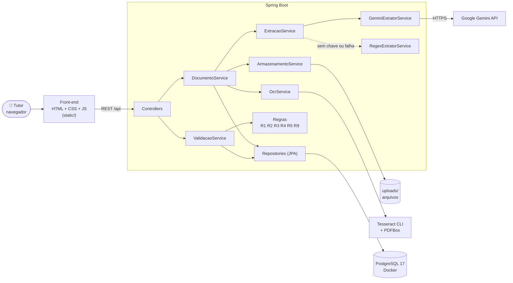
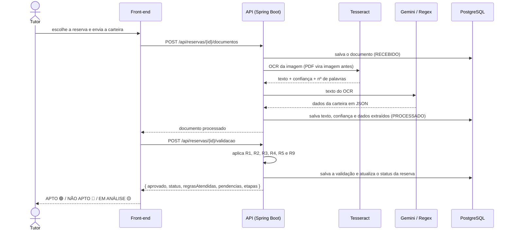

# 🐾 PetCheck-in: Validação Inteligente de Documentos

Projeto do semestre da **Mentoria Avanade** (ADS, CESAR School).

O tutor envia a **carteira de vacinação** do pet (foto ou PDF). O sistema lê o documento com
**OCR (Tesseract)**, extrai os dados com **IA (Gemini)**, ou com **Regex** quando a IA não está
disponível, aplica as regras de negócio e responde se o pet está **APTO**, **NÃO APTO** ou
**EM ANÁLISE MANUAL** para a hospedagem, dizendo ao tutor exatamente o que precisa ser corrigido.

## 🚦 Status
**MVP concluído.** Upload, OCR, extração com IA/Regex, regras R1–R5 e R9, API REST, interface web e
testes automatizados funcionando. Demonstração final: 30/11 a 04/12/2026.

## 📋 A proposta em 9 respostas

| # | Pergunta | Resposta |
|---|---|---|
| 1 | **Qual é o problema?** | Um hotel/creche para pets precisa conferir a carteira de vacinação de cada pet antes de aceitar a hospedagem. Feita à mão, a conferência é lenta, depende de atenção a várias datas e pode deixar passar uma vacina vencida, um risco para todos os animais hospedados juntos. |
| 2 | **Quem é o usuário?** | O **tutor**, que envia o documento e recebe na hora o resultado com as pendências. E a **equipe do hotel**, que recebe as reservas já conferidas e só olha de perto os casos duvidosos (em análise manual). |
| 3 | **Quais documentos?** | **Carteira de vacinação** do pet, em PNG, JPG ou PDF (até 10MB). O atestado veterinário já é aceito no envio, mas ainda não é validado (próximo passo). |
| 4 | **Quais dados são extraídos?** | Nome do pet, espécie, raça, data de nascimento, nome do tutor, CRMV do veterinário e a lista de vacinas (nome, tipo, data de aplicação e próxima dose). Do OCR vêm também a confiança da leitura e a quantidade de palavras. |
| 5 | **Quais regras?** | R1 documento legível · R2 campos obrigatórios · R3 antirrábica em dia · R4 polivalente em dia e compatível com a espécie · R5 vacinas válidas até o check-out · R9 nome do pet igual ao da reserva. Detalhes em [Regras de validação](#regras-de-validação-mvp). |
| 6 | **Quando aprova?** | Quando **todas** as regras são atendidas → **APTO**, e a reserva passa para `CONFIRMADA`. |
| 7 | **Quando rejeita?** | Se qualquer regra de R1 a R5 falhar → **NÃO APTO**, a reserva passa para `RECUSADA` e o tutor recebe as pendências (ex.: *"A vacina antirrábica está ausente, vencida ou vence durante a estadia. Atualize antes do check-in."*). Se só o nome divergir (R9), o caso vai para **EM ANÁLISE MANUAL**, porque pode ser apelido. |
| 8 | **Qual é o fluxo?** | Upload → OCR (Tesseract) → extração dos dados em JSON (Gemini, com fallback por Regex) → regras no Spring Boot → resultado salvo no PostgreSQL → API REST e tela mostram APTO / NÃO APTO / EM ANÁLISE. |
| 9 | **O que entra no MVP?** | Só carteira de vacinação de **cães**, vinculada a uma reserva já cadastrada, com as regras R1, R2, R3, R4 (apenas V8/V10), R5 e R9 (apenas o nome do pet), mais uma interface web simples para a demonstração. |

## 🏗️ Arquitetura



### Fluxo de uma validação



## 🛠️ Tecnologias
- Java 21 + Spring Boot 4 (Spring Web MVC, Spring Data JPA, Bean Validation)
- PostgreSQL 17 (Docker)
- Tesseract OCR 5 (via linha de comando) + Apache PDFBox (PDF → imagem)
- Google Gemini (`gemini-2.5-flash`) via API REST (`RestClient`) para extrair os dados em JSON
- Expressões regulares (Regex) como alternativa quando a IA não está disponível
- Jackson 3 (conversão de JSON)
- Front-end em HTML, CSS e JavaScript puro (servido pelo próprio Spring Boot)
- JUnit 5 + AssertJ (testes)

## ▶️ Como rodar

**Pré-requisitos:** Java 21, Docker e Tesseract com o idioma português
(`sudo apt install tesseract-ocr tesseract-ocr-por`).

1. Suba o banco de dados (PostgreSQL):
```bash
docker compose up -d
```

2. *(Opcional)* Configure a chave da IA. Sem ela, a extração usa Regex.
```bash
cp .env.example .env
# edite o .env e troque "coloque-sua-chave-aqui" pela sua chave do Gemini
# (gere em https://aistudio.google.com/apikey)
```
O arquivo `.env` está no `.gitignore`: a chave nunca vai para o GitHub.

3. Rode a aplicação:
```bash
./mvnw spring-boot:run
```

Abra **http://localhost:8080** no navegador para usar a interface.
A API fica em `http://localhost:8080/api`.
O banco fica disponível em `localhost:5433` (usuário/senha/banco: `petcheckin`).

Para desligar o banco: `docker compose down` (os dados são mantidos).

### 🧪 Testes
```bash
./mvnw test
```
- **45 testes.** Os **testes unitários** (JUnit 5 + AssertJ) não sobem o Spring: há uma classe de teste
  para cada regra (R1, R2, R3, R4, R5, R9), com a data de hoje fixada por `Clock.fixed`, e testes do
  `RegexExtratorService` usando o texto real que o OCR gerou do PNG e do PDF (`src/test/resources/ocr/`).
- O teste `contextLoads` sobe a aplicação inteira e **precisa do PostgreSQL rodando** (`docker compose up -d`).
  Para rodar só os unitários: `./mvnw test -Dtest='Regra*Test,RegexExtratorServiceTest'`.

## 📁 Estrutura do projeto
```
src/main/java/com/caiooliveira/petcheckin/
├── config/       → configurações (ex.: o relógio do sistema, Clock)
├── controller/   → recebe as requisições HTTP e devolve as respostas
├── dto/          → formatos dos dados que entram e saem da API
├── exception/    → exceções próprias e tratamento global de erros
├── service/      → regras de negócio
│   └── regras/   → uma classe por regra de validação (R1, R2, R3, R4, R5, R9)
├── repository/   → acesso ao banco de dados (Spring Data JPA)
└── model/        → entidades salvas no banco (Pet, Reserva, Documento, Validacao) e enums

src/main/resources/static/   → front-end (servido em http://localhost:8080)
├── index.html      → estrutura das telas e ícones SVG
├── css/estilos.css → visual (tema pet friendly)
└── js/app.js       → chamadas à API e comportamento das telas

src/test/                    → testes unitários e textos reais de OCR
docs/exemplos/               → carteiras fictícias para testar cada resultado
```

## 🖥️ Interface web
- **Documentos** (tela inicial): escolha a reserva, o tipo de documento e envie o arquivo
  (arrastar e soltar ou clique). Um *stepper* mostra as 4 etapas
  (Upload → Processamento → Validação → Resultado), e o resultado aparece em
  **verde (apto)**, **vermelho (não apto)** ou **amarelo (em análise)**, com regras atendidas e pendências.
- **Reservas**: cadastro e lista de reservas, com o status e o atalho "Enviar carteira".
- **Meus pets**: cadastro e lista de pets.
- **Resultados**: última validação de cada reserva.

## 🔌 Endpoints
| Método | Rota | Descrição |
|---|---|---|
| GET | `/api/health` | Verifica se a API está no ar |
| POST | `/api/pets` | Cadastra um pet |
| GET | `/api/pets` | Lista todos os pets |
| GET | `/api/pets/{id}` | Busca um pet pelo id |
| POST | `/api/reservas` | Cadastra uma reserva (status inicial: `AGUARDANDO_DOCUMENTOS`) |
| GET | `/api/reservas` | Lista todas as reservas |
| GET | `/api/reservas/{id}` | Busca uma reserva pelo id |
| POST | `/api/reservas/{id}/documentos` | Envia um documento (multipart: `arquivo` + `tipo`) |
| GET | `/api/reservas/{id}/documentos` | Lista os documentos da reserva |
| POST | `/api/reservas/{id}/validacao` | Valida a reserva com a carteira processada mais recente |
| GET | `/api/reservas/{id}/validacao` | Mostra o último resultado da validação |

### Exemplo: cadastrar um pet
```bash
curl -X POST http://localhost:8080/api/pets \
  -H "Content-Type: application/json" \
  -d '{"nome":"Thor","nomeTutor":"Caio Oliveira","especie":"CACHORRO","raca":"Golden Retriever","dataNascimento":"2022-03-15"}'
```

### Exemplo: cadastrar uma reserva
```bash
curl -X POST http://localhost:8080/api/reservas \
  -H "Content-Type: application/json" \
  -d '{"petId":1,"dataCheckin":"2026-12-01","dataCheckout":"2026-12-05"}'
```

### Exemplo: enviar a carteira de vacinação
```bash
curl -X POST http://localhost:8080/api/reservas/1/documentos \
  -F "tipo=CARTEIRA_VACINACAO" \
  -F "arquivo=@docs/exemplos/carteira_thor.png;type=image/png"
```
Formatos aceitos: PDF, PNG e JPG (máx. 10MB).

Depois do OCR, os dados da carteira são extraídos automaticamente
(com IA ou Regex, informado no campo `metodoExtracao`). Resposta (resumida):
```json
{
  "id": 5,
  "status": "PROCESSADO",
  "confiancaOcr": 94.8,
  "palavrasOcr": 64,
  "metodoExtracao": "REGEX",
  "dadosExtraidos": {
    "nomePet": "Thor",
    "especie": "CACHORRO",
    "raca": "Golden Retriever",
    "dataNascimento": "2022-03-15",
    "nomeTutor": "Caio Oliveira",
    "crmvVeterinario": "CRMV-PE 12345",
    "vacinas": [
      { "nome": "Antirrábica", "tipo": "ANTIRRABICA", "dataAplicacao": "2026-03-10", "proximaDose": "2027-03-10" },
      { "nome": "V10 (Polivalente)", "tipo": "POLIVALENTE", "dataAplicacao": "2026-04-15", "proximaDose": "2027-04-15" }
    ]
  }
}
```

### Exemplo: validar a reserva
```bash
curl -X POST http://localhost:8080/api/reservas/1/validacao
```
Resposta (resumida):
```json
{
  "aprovado": false,
  "status": "NAO_APTO",
  "regrasAtendidas": ["R1 - Documento legível", "R2 - Campos obrigatórios preenchidos", "..."],
  "pendencias": ["A vacina antirrábica está ausente, vencida ou vence durante a estadia. Atualize antes do check-in."],
  "etapas": [
    { "nome": "Upload", "concluida": true, "detalhe": "carteira_thor_vencida.png" },
    { "nome": "OCR", "concluida": true, "detalhe": "Confiança de 95.3%" },
    { "nome": "Extração", "concluida": true, "detalhe": "Dados extraídos com REGEX" },
    { "nome": "Validação", "concluida": true, "detalhe": "NAO_APTO" }
  ],
  "statusReserva": "RECUSADA"
}
```
Se a reserva ainda não tiver carteira processada, a API responde `400`.

### Regras de validação (MVP)
| Regra | O que verifica | Se falhar |
|---|---|---|
| R1 | Documento legível: confiança do OCR ≥ 70% e ≥ 20 palavras (`app.regras.*`) | NÃO APTO |
| R2 | Nome do pet, tutor, CRMV e ao menos uma vacina com data de aplicação | NÃO APTO |
| R3 | Antirrábica aplicada nos últimos 12 meses (e não no futuro) | NÃO APTO |
| R4 | Polivalente compatível com a espécie (cão: V8 ou V10) aplicada nos últimos 12 meses | NÃO APTO |
| R5 | Antirrábica e polivalente válidas até o check-out (próxima dose, ou aplicação + 12 meses) | NÃO APTO |
| R9 | Nome do pet no documento igual ao da reserva (sem acentos, maiúsculas e espaços) | EM ANÁLISE MANUAL |

Resultado → status da reserva: **APTO → `CONFIRMADA`**, **NÃO APTO → `RECUSADA`**,
**EM ANÁLISE MANUAL → `EM_ANALISE_MANUAL`**.

### Carteiras de exemplo (`docs/exemplos/`)
Todas fictícias, para a reserva do Thor (check-out em 05/12/2026):

| Arquivo | Resultado esperado |
|---|---|
| `carteira_thor.png` / `carteira_thor.pdf` | APTO |
| `carteira_thor_vencida.png` | NÃO APTO (antirrábica aplicada há mais de 12 meses) |
| `carteira_thor_vence_na_estadia.png` | NÃO APTO (antirrábica vence durante a estadia) |
| `carteira_thor_nome_diferente.png` | EM ANÁLISE MANUAL (nome "Thorzinho") |

Para gerar de novo (ex.: mudar datas): `python3 docs/exemplos/gerar_carteiras.py`.

### Formato dos erros
Todos os erros seguem o mesmo formato:
```json
{ "status": 404, "erro": "Pet não encontrado com id 999" }
```
Erros de validação também informam os campos com problema:
```json
{ "status": 400, "erro": "Dados inválidos", "campos": { "nome": "O nome do pet é obrigatório" } }
```

## 🧠 Decisões técnicas

### API e organização do código
- **Datas no padrão ISO 8601 (`aaaa-mm-dd`)**: é o formato universal entre sistemas
  (Java, PostgreSQL, JavaScript, IA), não é ambíguo e ordena corretamente.
  A conversão para `dd/mm/aaaa` é feita apenas na interface (front-end).
- **DTOs separados das entidades**: a API não expõe as entidades do banco;
  isso evita que o cliente altere campos indevidos (como o `id`) e concentra as validações de entrada.
- **Prefixo `/api` nas rotas**: separa os endpoints da API das páginas do front-end,
  servidas pelo mesmo servidor.
- **Rota aninhada `/api/reservas/{id}/documentos`**: deixa explícito que todo documento pertence a uma reserva.
- **Tratamento global de erros (`@RestControllerAdvice`)**: todas as respostas de erro têm o mesmo
  formato, em português e sem detalhes internos (stack trace), que ficam apenas no log do servidor.
  Os services lançam exceções de negócio e não conhecem HTTP.
- **Regras de entrada × regras de negócio**: validações de formato (campo obrigatório, data no passado)
  ficam nos DTOs com Bean Validation; regras que dependem do negócio ou comparam campos
  (ex.: check-out posterior ao check-in) ficam nos services e lançam `RegraNegocioException`.

### Documentos e OCR
- **Arquivos no disco, metadados no banco**: o arquivo é salvo na pasta `uploads/` e o banco guarda
  apenas o caminho e as informações do envio, mantendo o banco leve (padrão usado com storages como S3/Azure Blob).
- **Nome do arquivo gerado com UUID**: evita que um arquivo sobrescreva outro e impede nomes maliciosos
  (ex.: `../../`). O caminho interno não é exposto na API.
- **Tesseract chamado pela linha de comando (`ProcessBuilder`)**: evita os problemas de bibliotecas nativas
  do Tess4J no Linux e segue o modelo da mentoria (`app.ocr.comando`). O formato TSV devolve a confiança
  de cada palavra, usada como base da regra R1 (documento legível).
- **PDF convertido em imagem com PDFBox (300 DPI, tons de cinza)**: o Tesseract só lê imagens.
- **Falha no OCR não perde o envio**: o documento é salvo antes do processamento e, se o OCR falhar,
  fica com status `FALHA_PROCESSAMENTO`. O processamento é síncrono no MVP; em produção, o ideal
  seria uma fila assíncrona.

### IA e extração dos dados
- **IA com fallback por Regex**: se a chave do Gemini não estiver configurada, ou se a IA falhar
  (sem internet, limite de uso, timeout, resposta inválida), o sistema registra um aviso no log e
  extrai os dados com expressões regulares. O fluxo nunca para por causa da IA, e a resposta informa
  qual método foi usado (`IA` ou `REGEX`).
- **Interface `ExtratorDadosCarteira`**: Gemini e Regex implementam o mesmo contrato. Para trocar de
  IA (ex.: Azure OpenAI), basta criar outra implementação, sem mexer nas regras de negócio.
- **JSON mode + `temperature = 0`**: o Gemini é obrigado a responder em JSON (`responseMimeType`)
  e com temperatura zero, que dá respostas mais previsíveis. O prompt manda usar `null` quando a
  informação não estiver no texto, para a IA não inventar dados.
- **Timeouts na chamada à IA (10 s para conectar, 60 s para responder)**: uma IA lenta não trava o upload.
- **Chave da IA fora do código**: lida da variável `GEMINI_API_KEY` (ou do arquivo `.env`, ignorado
  pelo Git). O repositório tem apenas o `.env.example`, um modelo sem a chave.
- **Dados extraídos guardados como JSON (`TEXT`)**: o formato pode evoluir (novos campos, outros
  documentos) sem precisar mudar tabelas no MVP.
- **LGPD**: com a IA ligada, o texto da carteira (nome do tutor e do pet) é enviado a um serviço
  externo. Em produção, isso exigiria consentimento do tutor, contrato com o provedor e,
  de preferência, a anonimização dos dados pessoais antes do envio.

### Regras de validação
- **Uma classe por regra (interface `RegraValidacao`)**: cada regra é pequena, fácil de entender
  e de testar sozinha. O `ValidacaoService` recebe a lista de todas as regras por injeção de
  dependência; para criar a R6, basta criar uma nova classe, sem alterar o service.
- **`Clock` injetado**: as regras perguntam a data de hoje ao `Clock`, e não direto ao computador.
  Nos testes, um `Clock.fixed(...)` "congela" a data, e o resultado não muda com o passar do tempo.
- **Espécie e check-out vêm do cadastro, não do documento**: o que vale é o que foi reservado.
  O documento é a prova que está sendo conferida.
- **Nome divergente não reprova (R9)**: a carteira pode trazer um apelido ("Thorzinho"),
  então o caso vai para uma pessoa analisar, em vez de recusar a reserva automaticamente.
- **Pendências sem repetição**: R3 e R5 podem apontar o mesmo problema da antirrábica;
  a mensagem aparece uma vez só para o tutor.
- **Histórico de validações**: cada validação é salva (status, regras atendidas, pendências,
  data/hora e documento usado). O `GET` devolve a mais recente, e as anteriores ficam para auditoria.
- **Validação separada do upload**: o tutor pode enviar a carteira de novo e validar outra vez;
  a validação sempre usa a carteira processada mais recente.

### Front-end
- **JavaScript puro, servido pelo Spring**: sem framework e sem etapa de build,
  e tudo sobe com um único comando. Como front e API estão na mesma origem, não é preciso configurar CORS.
- **Proteção contra HTML malicioso**: todo texto vindo da API ou do usuário passa pela
  função `esc()` antes de entrar na página, para evitar XSS (ex.: um pet chamado `<script>`).
- **Validação do arquivo também no navegador**: o formato (PDF/PNG/JPG) e o tamanho (10MB) são
  conferidos antes do envio, para o usuário ter uma resposta imediata. O back-end continua validando,
  porque o front pode ser burlado.
- **Upload com `XMLHttpRequest`**: diferente do `fetch`, ele avisa quando o arquivo terminou de subir,
  e é isso que permite o stepper passar de "Upload" para "Processamento" no momento certo.
- **Datas em `dd/mm/aaaa` só na tela**: a API continua em ISO 8601, e a conversão acontece no `app.js`.

### Testes
- **Testes de regra sem o Spring**: as regras são classes comuns que recebem o que precisam pelo
  construtor, então o teste só faz `new RegraAntirrabica(relogioFixo)`. Os testes rodam em milissegundos
  e não dependem de banco, de internet nem da data do computador.
- **Testes nos limites**: além dos casos óbvios, os testes conferem as bordas (aplicada há exatamente
  12 meses passa; há 12 meses e 1 dia falha; próxima dose no dia do check-out passa), que é onde os erros
  costumam se esconder. Para conferir, a regra dos 12 meses foi alterada de propósito para 13 meses:
  os testes de limite falharam, provando que realmente protegem a regra.
- **Textos reais de OCR nos testes da Regex**: os textos do PNG e do PDF foram copiados do que o
  Tesseract gerou de verdade. No PDF, o OCR muda a ordem e joga os CRMVs para o fim, e o teste garante
  que a extração continua igual.

## ⚠️ Limitações conhecidas
- **Só carteira de vacinação de cães.** O atestado veterinário é aceito no envio, mas não é validado;
  gatos são aceitos na R4 (V3/V4/V5), mas não foram testados com carteiras reais.
- **OCR sensível à qualidade da imagem.** Não há pré-processamento: fotos tortas, com sombra, reflexo
  ou letra à mão podem reprovar na R1 ou perder dados (e cair na R2).
- **Regex depende do layout.** Sem a IA, a extração espera rótulos como `Nome do pet:` e vacinas com
  duas datas na mesma linha. Carteiras de outras clínicas podem não ser reconhecidas.
- **IA depende de conta e internet.** A chave do Gemini precisa de um projeto Google com acesso à API
  (nos testes, um projeto sem o plano gratuito respondeu `403`, e o fallback para Regex funcionou).
- **Processamento síncrono.** O envio espera o OCR e a IA terminarem (até 60 s no pior caso).
- **Sem autenticação.** Qualquer pessoa com acesso à API pode consultar ou validar qualquer reserva.
- **Análise manual sem tela própria.** O status `EM_ANALISE_MANUAL` é registrado, mas ainda não há uma
  tela para a equipe aprovar ou recusar o caso.
- **Não verifica autenticidade.** O CRMV é lido, mas não é consultado no conselho; carimbos, assinaturas
  e adulterações não são verificados.
- **Banco criado pelo Hibernate (`ddl-auto=update`).** Não há migrações versionadas, e as `check
  constraints` dos enums não são atualizadas automaticamente.

## 🚀 Próximos passos
- **Pré-processamento com OpenCV**: tons de cinza, remoção de ruído, binarização e correção de rotação
  antes do Tesseract, para ler melhor fotos de celular.
- **Atestado veterinário e as regras R6 a R8** da proposta, e as versões completas da R4 e da R9.
- **Fila assíncrona** (ex.: RabbitMQ ou Azure Service Bus): o envio responde na hora e o front
  acompanha o processamento.
- **Flyway** para versionar o banco com migrações SQL.
- **Autenticação e perfis** (Spring Security): tutor vê só os próprios pets; equipe do hotel analisa
  os casos manuais.
- **Tela de análise manual** para a equipe aprovar ou recusar com justificativa.
- **Armazenamento em nuvem** (ex.: Azure Blob Storage) no lugar da pasta `uploads/`.
- **Testes de integração** com Testcontainers (PostgreSQL de verdade nos testes da API).

## 🎬 Roteiro da demo (≈ 8 minutos)

**Antes de começar:** `docker compose up -d`, `./mvnw spring-boot:run`, navegador aberto em
`http://localhost:8080`, pasta `docs/exemplos/` aberta ao lado e `./mvnw test` já rodado uma vez.

1. **O problema (1 min):** a conferência manual da carteira de vacinação é lenta e sujeita a erro.
   Mostrar a [tabela das 9 respostas](#-a-proposta-em-9-respostas).
2. **Cadastro (1 min):** em **Meus pets**, mostrar o Thor; em **Reservas**, cadastrar uma reserva
   nova (status *Aguardando documentos*).
3. **Caminho feliz (1,5 min):** em **Documentos**, escolher a reserva, arrastar `carteira_thor.pdf`
   e processar. Mostrar o stepper, a confiança do OCR, o método de extração e o resultado **APTO** 🟢.
   Em **Reservas**, o status virou *Confirmada*.
4. **Vacina vencida (1 min):** enviar `carteira_thor_vencida.png` → **NÃO APTO** 🔴, com a pendência
   explicando ao tutor o que fazer.
5. **Nome diferente (1 min):** enviar `carteira_thor_nome_diferente.png` → **EM ANÁLISE** 🟡
   ("Thorzinho" pode ser apelido, então uma pessoa decide).
6. **Bastidores (1,5 min):** mostrar o JSON de `GET /api/reservas/{id}/validacao`, uma classe de regra
   (ex.: `RegraValidadeEstadia`) e o resultado do `./mvnw test`. Explicar o fallback IA → Regex.
7. **Fechamento (1 min):** decisões técnicas principais, limitações e próximos passos.

**Plano B:** a demo funciona **sem internet**, porque o OCR roda localmente e, sem a IA, a extração usa
Regex. Se algo falhar ao vivo, os `curl` da seção [Endpoints](#-endpoints) reproduzem o mesmo fluxo.
Para terminar com a reserva *Confirmada*, envie por último uma carteira em dia.

## 👤 Autor
Caio Martins Oliveira
